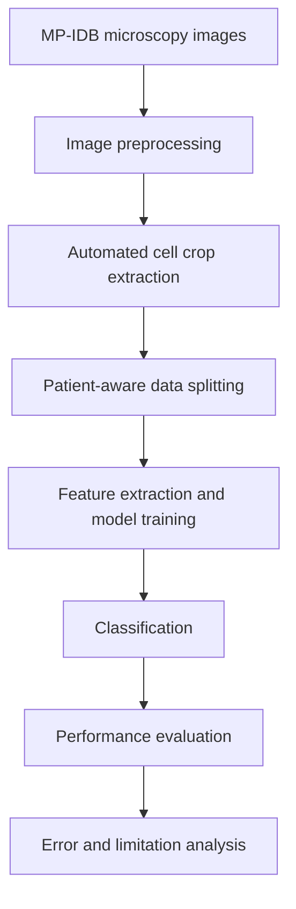

# 🔬 Multi-Species Malaria Parasite Classification

An experimental computer vision pipeline for classifying four *Plasmodium* species from microscopic blood-cell images using the **MP-IDB (Malaria Parasite Image Database)**.

Developed as my Bachelor's thesis in Computer Science at the University of Cagliari, where I graduated with **110/110 cum laude**, under the supervision of Prof. Cecilia Di Ruberto and Prof. Luca Zedda.

## 🎯 Project Overview

Identifying malaria parasite species from microscopy images is a challenging biomedical image-classification task. This project explores alternative image representations and classification strategies, from handcrafted image descriptors to deep features extracted by pretrained vision models and neural network fine-tuning.

The classification task covers four *Plasmodium* species:

- *Plasmodium falciparum*
- *Plasmodium vivax*
- *Plasmodium malariae*
- *Plasmodium ovale*

A central focus of the project is evaluating models under patient-aware data-splitting protocols and understanding how limited patient diversity and class imbalance affect the reliability of performance estimates.

## 👨‍💻 Contributions

- **Image preprocessing and crop extraction:** developed an automated preprocessing workflow for microscopy images, including LAB-based image segmentation and morphological operations to isolate infected red blood cell regions.
- **Patient-aware data splitting:** organized training, validation and held-out test partitions using patient-group identifiers (`group_id`) to reduce the risk of patient-level data leakage.
- **Feature extraction:** implemented feature-extraction workflows for pretrained vision models, saving representations alongside sample labels and metadata for subsequent inspection and classification.
- **Comparative modeling:** worked with handcrafted image features, deep representations and conventional classifiers, as well as neural network adaptation strategies.
- **Training and evaluation:** implemented a ResNet18 training workflow with ImageNet-pretrained weights, class-weighted cross-entropy, `WeightedRandomSampler` and lightweight geometric and color augmentation.
- **Error analysis:** examined class-wise performance and confusion between *P. malariae* and *P. ovale*, while assessing the effects of class imbalance and the limited number of independent patient groups.

## 🏗️ Pipeline Overview

## 🧠 Methods

### Image representations

The project explores complementary approaches to representing microscopy images:

- **Handcrafted features:** image descriptors used with conventional machine learning classifiers.
- **Deep features:** representations extracted from pretrained convolutional and transformer-based vision models.
- **Fine-tuning:** neural network adaptation strategies, including head-only and full fine-tuning, with LoRA also investigated in the broader experimental workflow.

### Classification and training

The documented experiments include:

| Component | Methods |
|---|---|
| Conventional classifiers | Logistic Regression, Random Forest, k-Nearest Neighbors |
| Deep feature extraction | Pretrained vision backbones, including ConvNeXt Tiny and ViT-B/16 |
| Neural network training | ResNet18 with ImageNet-pretrained weights |
| Training strategies | Class-weighted cross-entropy, `WeightedRandomSampler`, geometric and color augmentation |

The broader project context also includes experiments involving ResNet50, Swin Transformer, RedDino and DinoBloom. Results from these experiments are not combined here unless their evaluation protocols and metrics can be established reliably.

## 📊 Experimental Results

### ResNet18: held-out test evaluation

The documented ResNet18 experiment used ImageNet-pretrained weights, class-weighted cross-entropy, `WeightedRandomSampler` and the `geo_color_light` augmentation policy.

| Metric | Reported result |
|---|---:|
| Accuracy | 0.9655 |
| Macro F1-score | 0.9594 |
| Balanced accuracy | 0.9667 |
| Held-out test samples | 58 |

The held-out test set contains samples from all four species:

| Species | Test samples |
|---|---:|
| *P. falciparum* | 21 |
| *P. vivax* | 15 |
| *P. malariae* | 12 |
| *P. ovale* | 10 |
| **Total** | **58** |

The reported accuracy of 0.9655 is consistent with 56 correct predictions out of 58 samples, subject to rounding. The other metrics are reported in the experimental documentation and have not been independently recalculated from prediction-level outputs.

### Additional experiments

The project also includes deep-feature classification experiments, including ConvNeXt Tiny embeddings combined with Logistic Regression, as well as handcrafted-feature baselines and pretrained-model adaptation strategies.

Their results are kept separate from the ResNet18 result because the available records do not yet establish a sufficiently complete, consistent comparison across all configurations.

## ⚠️ Limitations

**Limited patient diversity.** The dataset contains few independent patient groups, especially for *P. vivax* and *P. ovale*. This limits the flexibility of patient-aware splitting and increases uncertainty in validation estimates.

**Incomplete class coverage across folds.** Some validation folds contain only *P. falciparum*. High accuracy on such folds does not demonstrate successful multiclass discrimination. Aggregate cross-validation metrics therefore require careful interpretation.

**Residual class confusion.** The documented ResNet18 error analysis identifies confusion between *P. malariae* and *P. ovale*. This highlights the importance of examining per-class metrics and prediction errors rather than relying on accuracy alone.

**Limited external validity.** A held-out subset from the same dataset does not establish generalization to independent institutions, acquisition settings or patient populations.

**Research use only.** This project is an experimental investigation of computer vision and machine learning methods. The reported results do not establish clinical readiness or support direct diagnostic use without further independent validation.

## 🔁 Reproducibility

The project uses Python and PyTorch. The documented feature-extraction workflow stores deep representations together with sample labels and metadata, allowing the generated feature files to be inspected.

The following feature-extraction and inspection scripts are documented in the project records:

- `scripts/phase4/extract_convnext_tiny_features.py` — extracts ConvNeXt Tiny features for the documented data splits.
- `scripts/phase4/inspect_convnext_tiny.py` — inspects the generated ConvNeXt Tiny feature files.
- `scripts/phase4/inspect_vitb.py` — inspects ViT-B/16 feature outputs.
- `scripts/phase4/inspect_swin.py` — inspects Swin Transformer feature outputs.

The feature-extraction logs show separate train, validation and held-out test files, with sample labels and group identifiers retained in the generated feature artifacts.

### Data requirements

Reproducing the experiments requires access to the original MP-IDB dataset, the corresponding preprocessing outputs and the original split files. The dataset is not included in this repository documentation.

A complete end-to-end reproduction also depends on the project's environment configuration, dependency versions and data-preparation steps. These requirements should be verified against the repository before running the experiments in a clean environment.

## 👨‍🎓 Author

**Leonardo Melis**

- M.Sc. student in Artificial Intelligence and Health (AIBH), University of Turin
- B.Sc. in Computer Science, University of Cagliari — 110/110 cum laude

[GitHub Profile](https://github.com/leonardomelis20)
