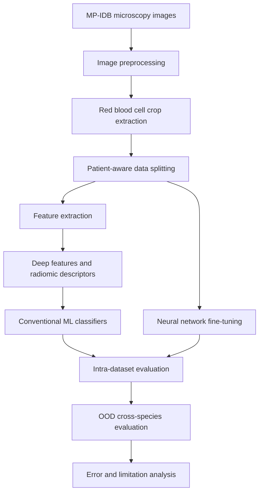

# 🔬 Multi-Species Malaria Parasite Classification

An experimental computer vision pipeline for classifying four *Plasmodium* species from microscopic blood-cell images using the **MP-IDB (Malaria Parasite Image Database)**.

Developed as my Bachelor's thesis in Computer Science at the University of Cagliari, where I graduated with **110/110 cum laude**, under the supervision of Prof. Cecilia Di Ruberto and Prof. Luca Zedda.

## 🎯 Project Overview

Identifying malaria parasite species from microscopy images is a challenging biomedical image-classification task. This project investigates alternative image representations and classification strategies, ranging from handcrafted radiomic descriptors to deep features extracted from pretrained vision models and neural network fine-tuning.

The classification task covers four *Plasmodium* species:

- *Plasmodium falciparum*
- *Plasmodium vivax*
- *Plasmodium malariae*
- *Plasmodium ovale*

A central focus is the comparison between conventional machine learning classifiers and deep learning representations, together with an investigation of how limited patient diversity and class imbalance affect model evaluation and cross-species generalization.

## 👨‍💻 Contributions

- **Image preprocessing and crop extraction:** developed an automated workflow for processing microscopy images and extracting infected red blood cell regions, including LAB-based segmentation and morphological operations.
- **Patient-aware data splitting:** organized data partitions using patient-group identifiers (`group_id`) to reduce the risk of patient-level data leakage between training and evaluation sets.
- **Deep feature extraction:** implemented workflows for extracting representations from pretrained vision models and storing features alongside sample labels and metadata for downstream analysis.
- **Radiomic feature engineering:** worked with 61 handcrafted image descriptors, covering first-order intensity statistics, gray-level co-occurrence matrix (GLCM) features and 2D geometric descriptors.
- **Comparative modeling:** evaluated deep representations and radiomic features with Logistic Regression, Random Forest and k-Nearest Neighbors classifiers.
- **Neural network adaptation:** investigated head-only and full fine-tuning, as well as Low-Rank Adaptation (LoRA), to compare alternative strategies for adapting pretrained models.
- **Training and evaluation:** investigated class-imbalance handling, data augmentation and class-wise performance.
- **Error and generalization analysis:** examined confusion between morphologically similar species, limitations arising from the small number of independent patient groups, and out-of-distribution (OOD) performance across species.

## 🏗️ Pipeline Overview

## 🧠 Methods

### Image representations

The project investigates three complementary approaches:

- **Radiomic features:** 61 handcrafted descriptors, including first-order intensity statistics, GLCM texture features and 2D geometric descriptors.
- **Deep features:** pretrained vision representations extracted from ResNet50, ConvNeXt Tiny, ViT-B/16, Swin-T, RedDino and DinoBloom.
- **End-to-end fine-tuning:** adaptation of pretrained neural networks using head-only training, full fine-tuning and LoRA.

### Classification and training

| Component | Methods |
|---|---|
| Deep learning backbones | ResNet50, ConvNeXt Tiny, ViT-B/16, Swin-T, RedDino, DinoBloom |
| Feature representations | Deep embeddings and 61 radiomic descriptors |
| Conventional classifiers | Logistic Regression, Random Forest, k-Nearest Neighbors |
| Fine-tuning strategies | Head-only, full fine-tuning, LoRA |
| Training techniques | Class-weighted cross-entropy, `WeightedRandomSampler`, geometric and color augmentation |
| Evaluation | Macro F1-score, accuracy, Matthews correlation coefficient (MCC), class-wise and OOD analysis |

## 📊 Experimental Results

### Intra-dataset comparison

The thesis reports the following leading configurations for conventional classification of pre-extracted features and neural network fine-tuning.

| Approach | Configuration | Macro F1-score | Accuracy |
|---|---|---:|---:|
| Deep features + classifier | ConvNeXt Tiny + Logistic Regression | **0.9788** | 0.9828 |
| Deep features + classifier | ViT-B/16 + Random Forest | **0.9788** | 0.9828 |
| Deep features + classifier | ViT-B/16 + Logistic Regression | **0.9788** | 0.9828 |
| Radiomic features + classifier | Radiomics + Random Forest | 0.9566 | 0.9655 |
| Fine-tuning | ConvNeXt Tiny, head-only | 0.9686 | 0.9741 |
| Fine-tuning | ResNet50, head-only | 0.9484 | 0.9569 |

*Results are reported from the thesis experiments. Feature-classification results and fine-tuning results come from different experimental procedures and should not be interpreted as a perfectly controlled comparison between all methods.*

The results show that pretrained deep representations combined with conventional classifiers can be highly competitive on this dataset. Radiomic features also provide a strong baseline, while fine-tuning does not consistently improve on conventional classification of frozen representations.

### Out-of-distribution generalization

To investigate transfer across species, the project also evaluates models in OOD settings, where the source and target species differ.

| Deep backbone | Reported mean macro F1 |
|---|---:|
| DinoBloom | **0.4638** |
| Swin-T | 0.3503 |
| ConvNeXt Tiny | 0.2727 |
| ResNet50 | 0.2714 |
| RedDino | 0.2578 |
| ViT-B/16 | 0.2565 |

DinoBloom achieves the highest aggregated OOD macro F1 among the evaluated deep backbones. However, performance varies substantially across source-target species pairs, and transfer to *P. malariae* remains particularly challenging in several experiments.

These findings suggest that strong intra-dataset discrimination does not necessarily translate into reliable cross-species generalization.

## ⚠️ Limitations

**Limited patient diversity.** The dataset contains 204 images associated with 17 patient-group identifiers, with substantial differences in the number of groups available for each species. This constrains the reliability and flexibility of patient-aware evaluation.

**Limited informative cross-validation folds.** Only two of the five validation folds contain all four species. Consequently, the estimate of variability across folds is limited, and results from folds lacking classes cannot establish reliable multiclass performance.

**Restricted OOD evaluation.** The limited number of independent groups restricts the number of feasible source-target species comparisons, particularly in the fine-tuning experiments.

**Uneven generalization across species.** Strong intra-dataset results coexist with considerably lower OOD performance. In particular, *P. malariae* is a challenging target in several cross-species experiments.

**Limited external validity.** Evaluation on a small dataset does not establish generalization to independent institutions, imaging devices, acquisition settings or patient populations.

**Research use only.** This project is an experimental investigation of computer vision and machine learning methods. Its results do not establish clinical readiness or support direct diagnostic use without further independent validation.

## 🔁 Reproducibility

The project uses Python and PyTorch. Feature-extraction workflows store deep representations alongside sample labels and metadata, supporting downstream classification and inspection.

The following scripts are documented in the project records:

- `scripts/phase4/extract_convnext_tiny_features.py` — extracts ConvNeXt Tiny features for the documented data splits.
- `scripts/phase4/inspect_convnext_tiny.py` — inspects generated ConvNeXt Tiny feature files.
- `scripts/phase4/inspect_vitb.py` — inspects ViT-B/16 feature outputs.
- `scripts/phase4/inspect_swin.py` — inspects Swin Transformer feature outputs.

The documented feature artifacts retain sample labels and group identifiers and distinguish train, validation and held-out test partitions.

### Data requirements

Reproducing the experiments requires access to the original MP-IDB dataset, the corresponding preprocessing outputs and the original split files. The dataset is not included in this repository.

A complete end-to-end reproduction also depends on the project's environment configuration, dependency versions and data-preparation steps. These requirements should be checked against the repository before attempting a clean reproduction.

## 👨‍🎓 Author

**Leonardo Melis**

- M.Sc. student in Artificial Intelligence for Biomedicine and Healthcare (AIBH), University of Turin
- B.Sc. in Computer Science, University of Cagliari — 110/110 cum laude

[GitHub Profile](https://github.com/leonardomelis20)
