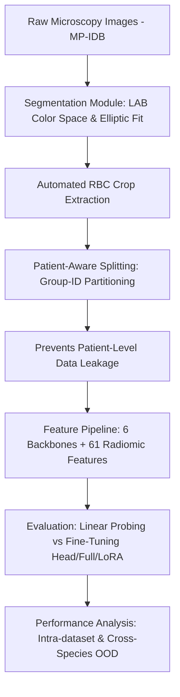

# 🔬 Multi-Species Malaria Parasite Classification Pipeline

An end-to-end computational framework for automated multi-species classification of *Plasmodium* parasites (*P. falciparum*, *P. vivax*, *P. malariae*, *P. ovale*) from microscopic red blood cell (RBC) images on the **MP-IDB** dataset.

Developed as part of my B.Sc. Thesis in Computer Science (*110/110 cum laude*) at the University of Cagliari, supervised by Prof. Cecilia Di Ruberto and Prof. Luca Zedda.

---

## 🎯 Project Overview & My Contribution

Diagnosing malaria and identifying the exact parasite species from thin blood smear images is vital for effective clinical treatment. This project systematically investigates how different feature representation strategies—ranging from traditional radiomic descriptors to domain-specific vision foundation models—perform under rigorous, patient-aware validation protocols.

### 👨‍💻 My Individual Contribution:
- **Pipeline Engineering:** Built an automated crop extraction pipeline leveraging LAB color-space segmentation, Otsu thresholding, and elliptical fitting.
- **Leakage-Free Validation Design:** Formulated a manual patient-aware splitting protocol (`group_id`) to completely eliminate patient-level data leakage between train, validation, and test partitions.
- **Benchmarking & Optimization:** Implemented and evaluated 6 diverse backbones across feature extraction (linear probing, RF, k-NN) and fine-tuning (`head_only`, `full`, `LoRA`) across both **Intra-dataset** and **Out-of-Distribution (OOD)** cross-species scenarios.

---

## 🏆 Key Results & Performance Benchmarks

All metrics reported below were evaluated on an **independent held-out test set of 58 cell samples** (from 4 distinct patient groups: 21 *P. falciparum*, 15 *P. vivax*, 12 *P. malariae*, 10 *P. ovale*), completely isolated during training and cross-validation.

| Approach | Model / Configuration | Evaluation Protocol | Macro F1 | Accuracy | Key Insight |
| :--- | :--- | :--- | :---: | :---: | :--- |
| **Deep Features** | ConvNeXt Tiny + Logistic Regression | Intra-Dataset (Held-Out Test) | **0.9789** | **0.9828** | Frozen features + linear classifier outperform full fine-tuning on limited medical data. |
| **End-to-End Fine-Tuning** | ConvNeXt Tiny (`head_only`) | Intra-Dataset (Held-Out Test) | **0.9686** | **0.9741** | High performance achieved with only 0.01% trainable parameters (3.07K params). |
| **Radiomic Features** | 61 Features + Random Forest | Intra-Dataset (Held-Out Test) | **0.9566** | **0.9655** | Highly competitive non-deep baseline operating without GPU compute. |
| **Domain Pre-Training** | DinoBloom (ViT-Base) | Out-of-Distribution (OOD) | **0.4638** | **0.5210** | Biological/hematology pre-training significantly improves cross-species adaptability over ImageNet weights. |

---

## 🏗 Architecture & Pipeline Flow

⚠️ Limitations & Scientific Context
Dataset Size & Class Imbalance: The MP-IDB dataset contains a restricted number of patient groups for minority species (P. ovale and P. vivax), limiting cross-validation fold balance.

Cross-Species OOD Generalization: While domain-specific pre-training (e.g., DinoBloom) helps, cross-species generalization remains challenging due to distinct morphological features across parasite life stages.

Research vs. Clinical Use: This work serves as an exploratory benchmark for computational vision models and is not certified for direct diagnostic clinical deployment without further multi-center validation.

🚀 Quickstart & Reproducibility
Prerequisites
Python 3.12

NVIDIA GPU with CUDA support (Gradient accumulation configured for 6GB VRAM)

Installation
Bash
# 1. Clone the repository
git clone [https://github.com/leonardomelis20/malaria-detection-pipeline.git](https://github.com/leonardomelis20/malaria-detection-pipeline.git)
cd malaria-detection-pipeline

# 2. Install dependencies
pip install -r requirements.txt
Reproducing Experiments
Bash
# Run feature inspection script for ConvNeXt Tiny
python scripts/phase4/inspect_convnext_tiny.py
Note on Data Access: Raw images belong to the public MP-IDB (Malaria Parasite Image Database). Crop extraction scripts require the original dataset structure placed under data/mp_idb/.

👨‍💻 Author
Leonardo Melis

M.Sc. Student in Artificial Intelligence and Health (AIBH) – Università degli Studi di Torino

B.Sc. Graduate in Computer Science (110/110 cum laude) – Università degli Studi di Cagliari

GitHub Profile
